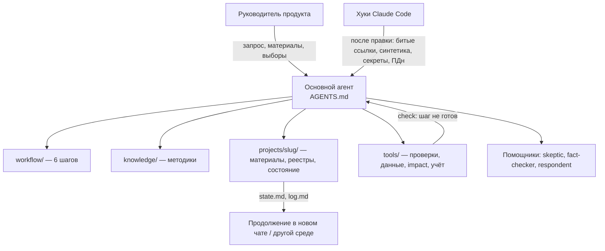

# Описание работы: «Стратег продуктов»

Черновик для итогового PDF. Места с пометкой ✍️ заполняются после прогона демо-проекта.

## 1. Что это

Репозиторий ИИ-агента для руководителя цифрового продукта: папка с инструкциями, методиками, шаблонами и скриптами. Её открывают в любой среде ИИ-разработки: Claude Code, Cursor, Codex, Copilot, OpenCode, GigaCode, Gemini CLI. Агент ведёт работу от размытого запроса до согласованных продуктовой и коммуникационной стратегий с планом проверки, а после решения следит за его основаниями.

## 2. Архитектура

### Процесс (workflow)

| Шаг | Результат | Человек |
|---|---|---|
| 1. Постановка задачи | `brief.md` | 🛑 согласует бриф |
| 2. Сбор материалов | `sources.md` | — |
| 3. Исследование | `research-plan.md`, `facts.md`, `unknowns.md`, `interviews.md`, `analysis/` | получает сводку пробелов |
| 4. Варианты | `options.md` (≥3, статус-кво, возражения от `skeptic`) | 🛑 выбирает вариант |
| 5. Стратегия | `product-strategy.md`, `comms-strategy.md` с проверкой обещаний | 🛑 утверждает |
| 6. План проверки и решение | `validation-plan.md`, `decisions.md`, `report.md` | — |

Переход между шагами возможен только после `strategist.py check`. Проверка требует, чтобы у фактов были источники, вариантов было не меньше трёх, человек сделал выбор, синтетика не служила доказательством, а обещания были подкреплены продуктом.

### Работа с контекстом и знаниями

- **Четыре слоя хранятся раздельно:** постоянные правила (`AGENTS.md`, `workflow/`), методики (`knowledge/`), материалы (`projects/*/materials/`, только чтение), состояние (`state.md`, `log.md`, `cost.md`).
- **Агент загружает только нужное:** файл текущего шага и методики, на которые он ссылается. Весь `knowledge/` сразу не читается.
- **Реестр утверждений с типами** (факт / вывод / гипотеза / прогноз / синтетика) и ID-ссылки `F…`/`S…` связывают каждый вывод с основанием. Прежний ответ агента не может стать «фактом»: свои файлы запрещено указывать как источник, и проверка это ловит.
- **Пересмотр:** `impact <ID>` проходит по цепочке зависимостей (источник → факты → выводы → варианты → стратегии → решения) и помечает затронутое в `state.md`.
- **Память между сеансами** — это файлы проекта. Хук SessionStart (в Claude Code) или протокол начала сессии (в остальных средах) показывает, где остановились.

## 3. Модели, сервисы и инструменты

| Компонент | Для чего |
|---|---|
| Основная модель среды ✍️ (например, Claude Opus / GPT / GigaChat) | рассуждения, варианты, стратегии |
| Субагент `skeptic` (та же модель) | независимые возражения |
| Субагент `fact-checker` (средняя модель, Sonnet) | сверка фактов с источниками |
| Субагент `respondent` (дешёвая модель, Haiku) | модельные интервью |
| Встроенный веб-поиск и чтение страниц среды | открытые источники |
| `tools/strategist.py` (Python, стандартная библиотека) | проекты, проверки шагов, журнал, учёт затрат, отчёт, impact, metrics |
| `tools/data_check.py` | паспорт таблиц CSV/XLSX |
| `tools/hook.py` + `.claude/settings.json` | хуки: статус проектов в начале сессии, проверка после каждой правки |
| `.claude/skills/` | навыки: пересмотр при новых данных, модельные интервью, паспорт данных |
| `tests/` (unittest) | автотесты инструментов на учебном проекте |

Платных сервисов и ключей, кроме подписки на среду агента, нет.

## 4. Ключевые промпты и инструкции

- `AGENTS.md` — роль, 8 жёстких правил, протокол начала сессии, переходы шагов, команды человека, поведение при сбоях.
- `workflow/01…06` — для каждого шага: цель, вход, действия, точка выбора, критерии готовности.
- `.claude/agents/skeptic.md`, `respondent.md`, `fact-checker.md` — роли помощников.
- ✍️ Вставить в PDF скриншоты фрагментов этих файлов.

## 5. Реализованные возможности дополнительного уровня

| Возможность | Как реализовано |
|---|---|
| Интервью и модельные респонденты | гайд и методика, субагент `respondent`, тип «синтетика» запрещён как доказательство |
| Анализ данных | `data_check.py`: единицы, периоды, пропуски, выбросы; расчёты отдельными скриптами в `analysis/` |
| Поддержка решений | `decisions.md`: основания, ответственный, условие пересмотра; команда «что решать сейчас?» |
| Пересмотр при новых данных | `impact` по цепочке зависимостей, навык `revise-on-new-data` |
| Маршрутизация | правила в `AGENTS.md`: дешёвые модели и скрипты для рутины, сильная модель для стратегии, повтор на сильной при плохом результате |
| Навыки, хуки, субагенты | `.claude/skills/` (3), `.claude/settings.json` (2 хука), `.claude/agents/` (3) |
| Устойчивость к сбоям | журнал действий, проверка `log.md` перед повтором, фиксация пробелов при недоступности источника |
| Переносимость | `AGENTS.md` как стандарт; переходники для Claude Code, Cursor, Copilot, Gemini; состояние в файлах |
| Сравнение с исходным способом | методика и шаблон в `benchmark/` ✍️ результаты после прогона |
| UX-анализ | частично: чтение скриншотов средствами среды, правило «только то, что видно» |

## 6. Время и расходы на демо-проект ✍️

- Время: …; минуты человека: …
- Стоимость: … (по `cost summary`)
- Ошибки агента и помощь человека: …

## 7. Возможности и ограничения

- Затраты записывает агент. Точность зависит от того, показывает ли среда реальный расход.
- Хуки и субагенты автоматически работают только в Claude Code. В остальных средах те же процедуры выполняются по инструкциям, без автоматического запуска.
- Работа с аудио и видео зависит от возможностей среды и отдельно не реализована.
- Маршрутизация моделей описана правилами. Автоматический выбор модели скриптом не реализован.
- Пересмотр находит зависимости только по явным ссылкам `F…`/`S…`: вывод без ссылки пересмотр не заметит. Поэтому ссылки обязательны.
