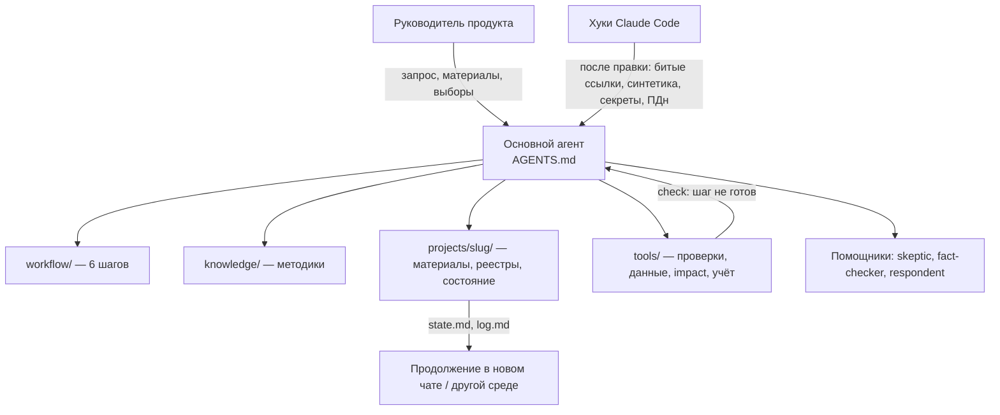

# Описание работы: «Стратег продуктов»

Черновик для итогового PDF. Места с пометкой ✍️ заполняются после прогона демо-проекта.

## 1. Что это

Репозиторий ИИ-агента для руководителя цифрового продукта: папка с инструкциями, методиками, шаблонами и скриптами. Её открывают в любой среде ИИ-разработки: Claude Code, Cursor, Codex, Copilot, OpenCode, GigaCode, Gemini CLI. Агент ведёт работу от размытого запроса до согласованных продуктовой и коммуникационной стратегий с планом проверки, а после решения следит за его основаниями.

## 2. Архитектура

### Процесс (workflow)

| Шаг | Результат | Человек |
|---|---|---|
| 1. Постановка задачи | `brief.md` | 🛑 согласует бриф |
| 2. Сбор материалов | `sources.md` | — |
| 3. Исследование | `research-plan.md`, `facts.md`, `unknowns.md`, `situation.md`, `interviews.md`, `analysis/` | получает картину ситуации |
| 4. Варианты | `options.md` (≥3, статус-кво, возражения от `skeptic`) | 🛑 выбирает вариант |
| 5. Стратегия | `product-strategy.md`, `comms-strategy.md` с проверкой обещаний | 🛑 утверждает |
| 6. План проверки и решение | `validation-plan.md`, `decisions.md`, `summary.md`, `report.md` | — |

Переход между шагами возможен только после `strategist.py check`. Проверка требует, чтобы у фактов были источники, вариантов было не меньше трёх, человек сделал выбор, синтетика не служила доказательством, а обещания были подкреплены продуктом.

### Работа с контекстом и знаниями

- **Четыре слоя хранятся раздельно:** постоянные правила (`AGENTS.md`, `workflow/`), методики (`knowledge/`), материалы (`projects/*/materials/`, только чтение), состояние (`state.md`, `log.md`, `cost.md`).
- **Агент загружает только нужное:** файл текущего шага и методики, на которые он ссылается. Весь `knowledge/` сразу не читается.
- **Реестр утверждений с типами** (факт / вывод / гипотеза / прогноз / синтетика) и ID-ссылки `F…`/`S…` связывают каждый вывод с основанием. Прежний ответ агента не может стать «фактом»: свои файлы запрещено указывать как источник, и проверка это ловит.
- **Пересмотр:** `impact <ID>` проходит по цепочке зависимостей (источник → факты → выводы → варианты → стратегии → решения) и помечает затронутое в `state.md`. Неверные и устаревшие утверждения не удаляются, а получают статус «отозван» / «устарел»: ссылка на отозванный факт в вариантах, стратегиях и резюме — ошибка проверки, решение на нём нужно поставить на пересмотр.
- **Память между сеансами** — это файлы проекта. Хук SessionStart (в Claude Code) или протокол начала сессии (в остальных средах) показывает, где остановились.

## 3. Модели, сервисы и инструменты

| Компонент | Для чего |
|---|---|
| Основная модель среды ✍️ (например, Claude Opus / GPT / GigaChat) | рассуждения, варианты, стратегии |
| Субагент `skeptic` (та же модель) | независимые возражения |
| Субагент `fact-checker` (средняя модель, Sonnet) | сверка фактов с источниками |
| Субагент `respondent` (дешёвая модель, Haiku) | модельные интервью |
| Встроенный веб-поиск и чтение страниц среды | открытые источники |
| `tools/strategist.py` (Python, стандартная библиотека) | проекты, проверки шагов, журнал, учёт затрат, отчёт, impact, metrics |
| `tools/data_check.py` | паспорт таблиц CSV/XLSX |
| `tools/pilot_size.py` | размер пилота для двух долей, поправка на группы, темп набора, заметный эффект при данном числе |
| `tools/extract_text.py` (+ `pdftotext` по желанию) | текст из DOCX/PPTX/PDF с номерами страниц и слайдов, пометка фраз-команд |
| `tools/hook.py` + `.claude/settings.json` | хуки: статус проектов в начале сессии, проверка после каждой правки |
| `.claude/skills/` | навыки: пересмотр при новых данных, модельные интервью, паспорт данных |
| `tests/` (unittest) | автотесты инструментов на учебном проекте |

Платных сервисов и ключей, кроме подписки на среду агента, нет.

## 4. Ключевые промпты и инструкции

- `AGENTS.md` — роль, 9 жёстких правил, протокол начала сессии, переходы шагов, команды человека, поведение при сбоях.
- `workflow/01…06` — для каждого шага: цель, вход, действия, точка выбора, критерии готовности.
- `.claude/agents/skeptic.md`, `respondent.md`, `fact-checker.md` — роли помощников.
- ✍️ Вставить в PDF скриншоты фрагментов этих файлов.

## 5. Реализованные возможности дополнительного уровня

| Возможность | Как реализовано |
|---|---|
| Интервью и модельные респонденты | гайд и методика, субагент `respondent`, тип «синтетика» запрещён как доказательство |
| Анализ данных | `data_check.py`: единицы, периоды, пропуски, выбросы; расчёты отдельными скриптами в `analysis/` |
| Поддержка решений | `decisions.md`: основания, ответственный, условие пересмотра; команда «что решать сейчас?» |
| Пересмотр при новых данных | `impact` по цепочке зависимостей, навык `revise-on-new-data` |
| Маршрутизация | правила в `AGENTS.md`: дешёвые модели и скрипты для рутины, сильная модель для стратегии, повтор на сильной при плохом результате |
| Навыки, хуки, субагенты | `.claude/skills/` (3), `.claude/settings.json` (2 хука), `.claude/agents/` (3) |
| Устойчивость к сбоям | журнал действий, проверка `log.md` перед повтором, фиксация пробелов при недоступности источника |
| Переносимость | `AGENTS.md` как стандарт; переходники для Claude Code, Cursor, Copilot, Gemini; состояние в файлах |
| Сравнение с исходным способом | методика и шаблон в `benchmark/` ✍️ результаты после прогона |
| Изображения, аудио, видео | `knowledge/ux-media.md`: скриншоты и макеты — источник `S…`, наблюдение — факт с местом «экран N» или таймкодом; аудио и видео — через расшифровку и кадры; заявленные границы. `extract_text.py` читает DOCX, PPTX, PDF и предупреждает о сканах и картинках |
| UX-анализ | `knowledge/ux-media.md`: задача пользователя → путь по экранам → проверка ценности, действия, цены, доверия, форм, композиции → барьеры-гипотезы → связь с «Проверкой обещаний» |
| База знаний: отзыв записей | статусы утверждений «действует / устарел / отозван»; ссылки на отозванное `check` не пропускает, строки не удаляются |

## 6. Проверка на реальных файлах

Учебный проект в `tests/fixture/` придуман вместе с инструментами и проверяет только предусмотренные случаи. Поэтому инструменты прогнали на настоящих разнородных материалах владельца проекта и на открытых сайтах. Сами материалы в репозиторий не попали: это сторонние документы, в одном есть контактные данные.

| Материал | Что нашлось | Что исправлено | Тест |
|---|---|---|---|
| Прайс-лист фулфилмента, XLSX: шапка с контактами, несколько таблиц на листе, цены текстом | Насчитано 16 384 столбца (лист отформатирован до конца); заголовками взята шапка; «28р.», «15р/ед.» не распознаны как суммы; **телефон попал в паспорт данных** | Пустые столбцы отбрасываются; строка заголовков ищется сама (`--header N` вручную); предупреждение «документ в виде таблицы»; суммы текстом с разными единицами; телефоны и e-mail скрываются; режим `--dump` с адресами ячеек | `test_data_check_price_list_like_sheet` |
| Презентация PPTX, 12 слайдов с заметками и 16 картинками | Работает: порядок слайдов, заголовки, заметки докладчика | Добавлено число изображений в шапке: агент знает, что их нужно смотреть отдельно | `test_pptx_order_titles_and_notes` |
| Документ DOCX из Pandoc: таблицы, промпты, 7 картинок | Промпты (стиль «Source Code») сливались с текстом; заголовок после списка склеивался со списком | Блоки кода по стилю; пустая строка перед заголовком; число изображений | `test_docx_structure_pages_and_injection` |
| Макет лендинга из Figma, PDF: 1 страница высотой ~11 400 pt | Текст извлекается, но вёрстка в несколько колонок перемешивается | Граница записана в `knowledge/ux-media.md`: макет смотреть как изображение | — |
| 2 скриншота чужих лендингов | Материал для разбора интерфейсов | Методика `knowledge/ux-media.md` | — |
| Голосовое сообщение, 19 с | Агент звук не распознаёт ни в одной среде | Граница заявлена: аудио — только через расшифровку | — |
| return.me | Работающий аналог; на самой странице «Family-run since 2003» и «Trusted worldwide since 2007» | Правило: противоречия на сайте — два факта и вывод о расхождении | — |
| returnme.ai | Встроенное чтение страниц вернуло пустую оболочку (сайт на JavaScript); по сути — не аналог, а тёзка (перепродажа возвратов e-commerce) | Правила: пустую страницу не пересказывать, просить PDF; тёзку не считать конкурентом | `test_referenced_files_exist` (ссылки на методику) |

Итог: на шести реальных файлах и двух сайтах найдено 7 недочётов инструментов и 4 пробела в инструкциях; всё исправлено и закреплено тестами или правилами. Работа человека — около 15 минут (подобрать файлы), агента — около 40 минут.

## 7. Пробный прогон на второй задаче: «Возвратим»

Задача владельца проекта: сервис возврата потерянных вещей по QR-стикеру с вознаграждением нашедшему. Вопрос — запускать ли первую версию и как объяснить ценность. Прогон сделан 18.11.2026 в облачной сессии Claude Code: агент начинал с нуля, без подсказок о своём устройстве, человек отвечал только как руководитель продукта. Результат — `projects/vozvratim/` (отчёт `report.md`, резюме `summary.md`).

**Что получилось (`strategist.py metrics vozvratim`):** 43 источника, 71 утверждение (44 факта — все с проверяемым источником, 19 выводов, 7 гипотез, 1 прогноз), 12 названных пробелов, 5 вариантов с 15 возражениями, 6 обещаний — все подкреплены продуктом, 4 решения с условиями пересмотра, 31 запись в журнале.

**Что сработало без вмешательства:**

| Механизм | Как проявился |
|---|---|
| Записка из материалов, написанная другим ИИ-агентом | Принята как «замысел и набор гипотез», а не как доказательство |
| Тёзка и мусор в материалах | returnme.ai и две карточки товаров (табличка для автомобиля, сбор отзывов) распознаны как нерелевантные |
| Сбой сети | Отмечен в журнале; агент переключился на окружение с доступом, открыл сайты браузером; где не вышло — понизил уверенность, а не пересказал по выдаче |
| Повреждённый текст PDF | Замечен, страницы прочитаны как изображения |
| `fact-checker` (2 раза) | 12 из 15 ключевых фактов подтверждены, 3 вывода оказались шире оснований — отозваны и заменены |
| Новые данные (PDF i-lost.ru) | Опровергли 2 вывода и состарили 1 факт: статусы «отозван» / «устарел», обновлены картина ситуации и пробелы, таблица «что стало с выводами» |
| Перерыв | «Стоп» → новый чат → «Продолжи проект vozvratim»: продолжил с шага 4 без повторов |
| `skeptic` (2 раза) | Шаг 4: пропущенный вариант из брифа, бюджет без основания, ссылки не по делу. Шаг 5: гарантия держалась на добросовестности владельца, текст стикера обещал больше продукта, ворота ничего не измеряли. Всё исправлено до показа человеку |
| Проверка обещаний | Слово «гарантирована» убрано со стикера до заключения юриста |
| Правка руководителя | По просьбе «покажи экономику» — расчёт скриптом в `analysis/`, который нашёл ошибку агента: порог «предоплата ≤ 990 ₽» означал работу в минус → исправлен на ≤ 500 ₽ |
| Поддержка решений | «Что решать сейчас?» — честно «пересматривать нечего», плюс какие опоры ослабли и к какому решению относятся |

**Ошибки агента и что исправлено в репозитории:**

| Что было | Исправление |
|---|---|
| Промежуточные сообщения на английском | `AGENTS.md`: по-русски всё, что видит человек |
| На точке утверждения: «если не уточните — исхожу из „да“» | `AGENTS.md`: на 🛑 только явный ответ |
| Агент отложил стратегию до реальной проверки «ворот» — прогон бы встал | `workflow/05`: условный вариант → условная стратегия, ворота — первым этапом плана проверки |
| Массовая замена испортила подсказку в `state.md` | Шаблон без значений в подсказке; `state.md` меняется командой `set` |
| Отчёт собрался со старым номером шага | `report` считает готовые шаги по проверкам |
| Пустой раздел «Интервью» в отчёте | Пустые заготовки в отчёт не попадают |
| `extract_text` не предупредил о повреждённом тексте PDF | Такие страницы помечаются, совет читать как изображения |

**Затраты (по записям агента в `cost.md`):** ~665 тыс. токенов, ≈ 12 $, 11 минут человека (оценка агента). ✍️ Сверить с реальным расходом в настройках claude.ai и реальным временем человека.

**Ограничения прогона:** в облачной сессии сеть закрыта почти для всех сайтов, поэтому часть фактов осталась «по поисковой выдаче» с низкой уверенностью; модельные респонденты не понадобились и не показаны.

## 8. Репетиция на брифе МегаФона

Бриф «Связь для близких и собственных устройств» опубликован 19.11.2026. До записи видео агента прогнали по нему в копии репозитория: отдельный агент начинал с нуля (только `AGENTS.md` и файлы), за руководителя в точках выбора отвечал человек-оператор; затем другой агент «с нуля» продолжил проект и обработал новые данные. Файлы репетиции в репозиторий не вошли — на видео агент делает всё заново.

**Что прошло без вмешательства:** бриф (11 стр.) прочитан целиком, предложены три кандидата и обязательные «оставить» / «свернуть»; 31 утверждение со ссылками на страницы брифа, 11 пробелов, расчёты скриптами; разложено отставание базового года (≈667 из 1 000 активных групп — из-за числа групп, ≈333 — из-за доли активных); честный вывод «цель 285 млн одной услугой не достигается»; прогноз по пяти строкам в трёх сценариях, ориентир на третий год, размер пилота с поправкой на семьи (1 638 номеров на группу сравнения — совпало со стандартной формулой); продолжение в новом чате без повторов; новые данные — 5 прогнозов помечены «устарел», пересчёт скриптом, замечено, что обещание «в момент низкого остатка» стало неточным, утверждённые стратегии без согласия не правились. Расход по оценке агента — ≈5,3 $.

**Ограничение репетиции:** вложенный агент не может вызвать своих помощников, поэтому `skeptic` и `fact-checker` выполнены «отдельным проходом» по инструкции. В обычном Claude Code они работают как субагенты (подтверждено прогоном «Возвратим»).

**Слабые места и исправления:**

| Что нашлось | Исправление |
|---|---|
| Бриф требует «один документ из пяти частей» и «расчёты рядом с решениями», а отчёт собран из рабочих файлов — план по кварталам, ресурсы и риски оказались внутри «Экономики» | `brief.md › Формат результата` (структура заказчика, любое число частей) → `deliverable.md` строго по ней; `check --step 6` сверяет части по смыслу названий; в отчёте документ заказчика идёт сразу после резюме |
| В шаблонах нет разделов типичного бизнес-брифа; появились только после подсказки | Необязательные разделы плана: прогноз по сценариям, этапы, ресурсы, риски, просьба к руководителю; методика пилота в `knowledge/validation.md` |
| Размер пилота агент каждый раз считает своим кодом | `tools/pilot_size.py` |
| 4 вопроса вместо 3 | `workflow/01`: «один пункт — один вопрос» |

## 9. Переносимость: прогон в OpenCode на других моделях

Участник команды прошёл тот же бриф по инструкции для товарища — в **OpenCode** на **DeepSeek V4.1 Flash** и **Nemotron 3.5 Super VL** (бесплатные облегчённые модели), репозиторий версии `031385b` без изменений. Результат — `projects/svyaz-blizkih-opencode/`; продолжение готового «Возвратим» в OpenCode — `projects/vozvratim-opencode/`.

| | Claude Code (основной демо) | OpenCode (перенос) |
|---|---|---|
| Проверки шагов 1–6 | все проходят, 0 предупреждений | все проходят, 0 предупреждений |
| Документ из пяти частей брифа | есть | есть |
| Перерыв и продолжение в новой сессии | на шаге 6 | на шаге 4 |
| Факты с источником / пробелы | 24/24 / 15 | 18/18 / 12 |
| Варианты / возражения | 10 / 21 | 6 / 22 |
| Модельные интервью | — | 3 (синтетика, только гипотезы) |
| Рекомендация | диагностика I кв. → пилот сигнала организатору | этап 0 → пилот раннего сигнала организатору — **совпала по сути** |
| Оценка вклада в прибыль | 0…0,15 млн руб. | 2,9…7,2 млн руб. (оптимистичнее, держится на допущении) |
| Новые данные | пересчёт, «устарел» / «отозван» | новые факты, решения на пересмотр, без пометок «устарел» |

Вывод: процесс, проверки, точки выбора, перерыв и структура заказчика переносятся в другую среду и на другие модели; глубина и осторожность выводов на облегчённых моделях ниже. Продолжение «Возвратим» в OpenCode: агент восстановился по файлам, а вымышленные проверочные данные завёл как синтетику, а не как факты.

## 10. Время и расходы на демо-проект ✍️

- Время: …; минуты человека: …
- Стоимость: … (по `cost summary`)
- Ошибки агента и помощь человека: …

## 11. Возможности и ограничения

- Затраты записывает агент. Точность зависит от того, показывает ли среда реальный расход.
- Хуки и субагенты автоматически работают только в Claude Code. В остальных средах те же процедуры выполняются по инструкциям, без автоматического запуска.
- Аудио и видео агент сам не распознаёт: нужны расшифровка и кадры-скриншоты от человека. Сканы PDF читаются только средствами среды.
- Сайты, которые собираются скриптами в браузере, встроенное чтение страниц часто возвращает пустыми. Агент не пересказывает их, а просит сохранить страницу как PDF.
- Номера страниц в DOCX приблизительные: они зависят от разметки, сохранённой Word.
- Маршрутизация моделей описана правилами. Автоматический выбор модели скриптом не реализован.
- Пересмотр находит зависимости только по явным ссылкам `F…`/`S…`: вывод без ссылки пересмотр не заметит. Поэтому ссылки обязательны.
